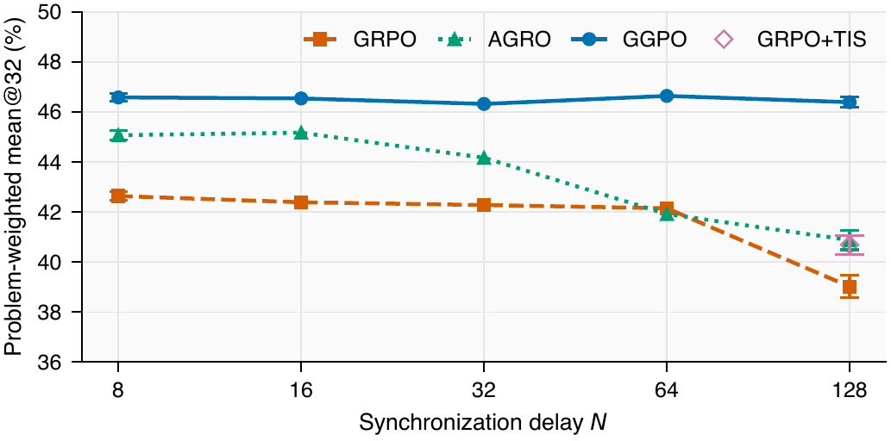

# Gibbs-Gap Policy Optimization (GGPO)

Official code for **Gibbs-Gap Policy Optimization for Off-Policy RL with Verifiable Rewards**.

Xuanchang Zhang · Tong Zhang

University of Illinois Urbana-Champaign

[Paper](https://arxiv.org/abs/2610.20814) · [Reproduction](examples/ggpo/REPRODUCTION.md) · [Experiment scripts](examples/ggpo/README.md)

GGPO learns from groups of responses generated by a different, possibly stale policy, without learner-to-behavior importance weights. It minimizes a log-mean-exp gap of KL-adjusted rewards within each prompt group.

## Key results

### Mathematical reasoning

Main results from Table 1 of the paper: problem-weighted mean@32 accuracy (%) across five mathematical-reasoning benchmarks, at the final checkpoint after 8,000 optimizer updates. The default setting uses controlled policy staleness, $N=8$.

| Base model | GRPO | AGRO | GGPO |
|---|---:|---:|---:|
| Qwen3-1.7B-Base | 42.64 | 45.07 | **46.58** |
| Qwen3-4B-Base | 55.51 | 55.81 | **56.98** |

The average gives equal weight to all 1,506 problems in MATH-500, AIME 2024, AIME 2025, OlympiadBench, and Minerva Math. The paper reports three-seed means for 1.7B and seed 42 for 4B; see the paper for the full benchmark breakdown and uncertainty estimates.

### Controlled policy staleness



Figure 2 of the paper: Qwen3-1.7B-Base across behavior synchronization intervals $N=8,16,32,64,128$. Larger $N$ means more learner updates before collecting fresh responses. GGPO maintains its accuracy as the synchronization interval increases. Results at $N=8,128$ are three-seed means; intermediate intervals use seed 42. [Vector figure](docs/assets/ggpo-staleness.pdf).

## Reproduce

The experiments use four NVIDIA GH200 GPUs. Start with the GPU software environment and pinned dependencies in the [installation guide](examples/ggpo/REPRODUCTION.md#installation), then [prepare the datasets](examples/ggpo/REPRODUCTION.md#data-preparation) and launch GGPO:

```bash
export CONDA_ENV_NAME=your-conda-environment
export DATA_ROOT=/path/to/ggpo-data
ALGORITHM=ggpo SEED=42 bash examples/ggpo/run_math.sh
```

The [reproduction guide](examples/ggpo/REPRODUCTION.md) covers all baselines, model sizes, policy-staleness settings, fixed-pool offline training, checkpoint resume, and evaluation. It also records the objective, software versions, batching, and numerical precision. Step counts refer to optimizer updates.

## Citation

```bibtex
@misc{zhang2026ggpo,
  title = {Gibbs-Gap Policy Optimization for Off-Policy RL with Verifiable Rewards},
  author = {Xuanchang Zhang and Tong Zhang},
  year = {2026},
  eprint = {2610.20814},
  archivePrefix = {arXiv},
  primaryClass = {cs.LG},
  url = {https://arxiv.org/abs/2610.20814}
}
```

## Acknowledgements and license

This implementation builds on [verl](https://github.com/verl-project/verl). The repository also includes a modified copy of [AReaL](https://github.com/areal-project/AReaL). We retain the [Apache 2.0 license](LICENSE), [upstream copyright notice](Notice.txt), and [third-party notices](THIRD_PARTY_NOTICES.md).
